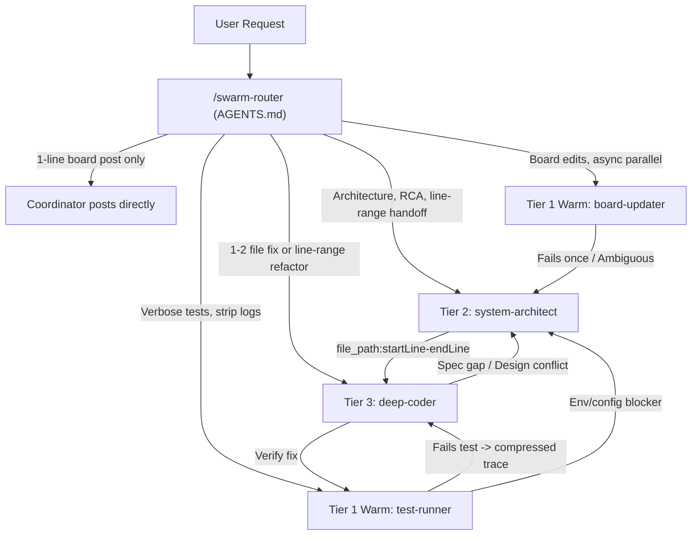

# antigravity-swarm-router

**Make Swarm Smarter, Not More Expensive.**

[](https://github.com/Anuphap2/antigravity-swarm-router/actions/workflows/ci.yml)
[](https://github.com/Anuphap2/antigravity-swarm-router/releases)
[](LICENSE)

A plug-and-play `AGENTS.md` + `.agent/skills/` router for **Antigravity Swarm Mode** that cuts primary-model quota drain, shrinks test logs by **85–94%**, and reuses warm Tier-1 workers across multi-step builds.

---

## Before vs. After (in 10 Seconds)

```text
BEFORE (Standard Swarm)
  All workers on Hydrogen/Neon -> board edits + 7 KB verbose logs drain primary quota
  Every sub-task cold-spawns   -> 7 spawns, full files read, repeated SKILL/context loads

AFTER (antigravity-swarm-router)
  Tier 1 (Argon / Claude Low)  -> 0% Hydrogen/Neon drain on board updates & test runs
  test-runner compression      -> 7,310 B raw test log -> 849 B (1 line) sent to Neon (-88.4%)
  Line-range + #seq handoffs   -> 7 / 141 lines read (-95.0%), 308 B brief (-75.3%)
  Warm reuse + async board     -> 13 dispatches executed with 4 spawns / 9 reuses
```

---

## Quick Start (3 Steps)

### 1. Install into your project

**macOS / Linux (Bash):**
```bash
curl -fsSL https://raw.githubusercontent.com/Anuphap2/antigravity-swarm-router/main/install.sh | bash
```

**Windows (PowerShell):**
```powershell
irm https://raw.githubusercontent.com/Anuphap2/antigravity-swarm-router/main/install.ps1 | iex
```

<details>
<summary>Presets, Update, and Uninstall options</summary>

| Preset | Tier 1 (`TIER_LOW`) | Behavior |
| :--- | :--- | :--- |
| `quota-saver` *(default)* | `gemini-4-argon-low` | Isolated pool; `0%` drain on `Hydrogen`/`Neon` (~39s cold / ~18–35s warm) |
| `balanced` | `claude-sonnet-5-5-low` | Isolated pool + ~2× faster Tier 1 (~18s) |
| `speed-first` | `gemini-3.8-flash-low` | Fastest Tier 1 (~13s), shares Gemini pool |

```bash
# Bash: install with preset / update skills only (keeps AGENTS.md) / uninstall
curl -fsSL https://raw.githubusercontent.com/Anuphap2/antigravity-swarm-router/main/install.sh | bash -s -- . --preset balanced
curl -fsSL https://raw.githubusercontent.com/Anuphap2/antigravity-swarm-router/main/install.sh | bash -s -- . --update
curl -fsSL https://raw.githubusercontent.com/Anuphap2/antigravity-swarm-router/main/install.sh | bash -s -- . --uninstall
```

```powershell
# PowerShell: install with preset / update skills only (keeps AGENTS.md) / uninstall
& ([scriptblock]::Create((irm https://raw.githubusercontent.com/Anuphap2/antigravity-swarm-router/main/install.ps1))) -TargetDir . -Preset balanced
& ([scriptblock]::Create((irm https://raw.githubusercontent.com/Anuphap2/antigravity-swarm-router/main/install.ps1))) -TargetDir . -Update
& ([scriptblock]::Create((irm https://raw.githubusercontent.com/Anuphap2/antigravity-swarm-router/main/install.ps1))) -TargetDir . -Uninstall
```

Both installers preserve unrelated files inside `.agent/` and prompt before overwriting or removing `AGENTS.md` (pass `--force` / `-Force` for non-interactive mode).

</details>

### 2. Open a new Antigravity chat
Antigravity discovers `AGENTS.md` and `.agent/skills/*/SKILL.md` on session start.

### 3. Run `/swarm-router`
```text
/swarm-router Fix the race condition in cache.py, run tests, and update BOARD.md
```
Or target a single tier directly: `/board-updater`, `/test-runner`, `/system-architect`, `/deep-coder`.

---

## Standard Swarm vs. `antigravity-swarm-router`

| Dimension | Standard Swarm | `antigravity-swarm-router` |
| :--- | :--- | :--- |
| **Model Selection** | Coordinator's heavy model on every worker | 3-tier routing (`TIER_LOW`, `TIER_ARCHITECT`, `TIER_CODER`) |
| **Primary Pool Drain** | Board & test runs consume `Hydrogen`/`Neon` | Isolated Tier 1 (`Argon` / `Claude Low`) -> **0% primary drain** |
| **Test Log Handling** | Coder reads full verbose test logs | `test-runner` strips passing noise -> `file:line` + error only |
| **Cross-Worker Handoffs** | Repeated specs or whole-file reads | `#seq` references + `file_path:startLine-endLine` |
| **Worker Lifecycle** | Cold-spawn per task; blocking board waits | **Warm Tier-1 reuse**, **async board updates**, **micro-task bypass** |
| **Stalls & Failures** | May retry/loop or hang silently (`waiting`) | **1-strike Fail-Fast** + **Silent-Stall Watchdog** + **Fallback Pool** |

### Measured Benchmarks (Reproducible)

| Metric | Baseline | `antigravity-swarm-router` | Measured Impact |
| :--- | :--- | :--- | :--- |
| **Primary Pool (`Hydrogen`/`Neon`) on Board/Test** | 100% of tasks | **0%** (isolated `Argon` / `Claude` pool) | **100% primary pool saved** |
| **Multi-Step Pipeline (7 sub-tasks)** | 171s sequential sum / 7 cold spawns | **109s / 4 spawns** (async + warm reuse) | **36.3% faster, -42.9% spawns** |
| **Line-Range Read Scope (`Neon` on 141-line file)** | 141 lines (100%) | **7 lines** (`pricing_service.py:123-129`) | **-95.0% lines read** |
| **Verbose Test Log (`test-runner`)** | 2,019–3,036 chars raw log | **297 chars** (`[FAIL]`) / **117 chars** (`[OK]`) | **-85.3% to -94.2% log size** |
| **Cross-Worker Handoff Brief** | 1,245 chars (full spec) | **308 chars** (`read_board{seqs:[7]}`) | **-75.3% handoff size** |
| **1–2 File Fix (Single-Worker Threshold)** | 59s / 2 workers (2-stage split) | **34s / 1 worker** (with test pass) | **42.4% faster, -50% workers** |
| **Single Small Board Task Latency (Trade-off)** | **11s** (`Hydrogen`) | 18s (`Claude`) / 39s (`Argon`) / 13s (`3.8 Flash`) | **+2s to +28s** on 1-off cold task |

### Production Case Study (`seat-lock-demo` — 19 Unit Tests + Live UI)

Full-stack concurrency app (5×5 seat map with 30s TTL locks) built end-to-end via `/swarm-router`:

| Metric | Observed Result |
| :--- | :--- |
| **Worker Spawns vs. Warm Reuses** | **4 spawns / 9 reuses** across **13 dispatches** (`@board-updater` hit 6-turn Context Cap cleanly) |
| **TDD Red Test Log Compression** | **7,310 B (114 lines)** raw log -> **849 B (1 line)** sent to `Neon` (**-88.4% bytes, -99.1% lines**) |
| **Primary Pool Offloaded** | **9 of 13 tasks** (6 board + 3 test runs) executed on `Argon` (**0%** `Hydrogen`/`Neon` drain) |
| **Verification & Fault Recovery** | **19/19 unit tests passing**, live browser UI verified; recovered from 2 transient network errors |

> **Reproduce it yourself:** Generate the exact fixture with `python tests/setup-bench.py /tmp/swarm-bench` and follow [tests/repro-benchmark.md](tests/repro-benchmark.md). Verify your own models first via [tests/swarm-smoke-test.md](tests/swarm-smoke-test.md). *(Tested on Antigravity, Nov 2026; self-reported benchmarks.)*

---

## Architecture & Model Configuration



Edit all tier and fallback models in the top table of [AGENTS.md](AGENTS.md) (see [examples/custom-models.md](examples/custom-models.md) for cross-provider examples):

| Tier | Variable | Default (`quota-saver`) | Fallback Pool | Skill Path |
| :--- | :--- | :--- | :--- | :--- |
| Tier 1 (Board) | `TIER_LOW` | `gemini-4-argon-low` | `claude-sonnet-5-5-low` | `.agent/skills/board-updater/SKILL.md` |
| Tier 1 (Tests) | `TIER_LOW` | `gemini-4-argon-low` | `claude-sonnet-5-5-low` | `.agent/skills/test-runner/SKILL.md` |
| Tier 2 (Architect) | `TIER_ARCHITECT` | `gemini-4-hydrogen-high` | `claude-sonnet-5-5-medium` | `.agent/skills/system-architect/SKILL.md` |
| Tier 3 (Deep Coder) | `TIER_CODER` | `gemini-4-neon-high` | `claude-opus-5-5-high` | `.agent/skills/deep-coder/SKILL.md` |

---

## Troubleshooting

- **`/swarm-router` does not appear in `/` menu:** Open a **new** Antigravity chat after installing so skills are reloaded, and confirm `.agent/skills/swarm-router/SKILL.md` (or `~/.gemini/config/skills/swarm-router/SKILL.md`) exists.
- **`swarm add` rejects a model ID:** Model IDs vary by account/date. Run `swarm{action: "models", all: true}` and update `AGENTS.md`.
- **A Tier-1 worker goes to `waiting` without posting:** Some models skip `post_message` (observed in `gpt-oss-120b-medium`). The **Stuck-Worker Watchdog** kills it and switches to `claude-sonnet-5-5-low` — run [tests/swarm-smoke-test.md](tests/swarm-smoke-test.md) to vet new models first.
- **`install.sh` shows `\r: command not found`:** Pull from `main` or convert CRLF to LF (`sed -i 's/\r$//' install.sh`). `.gitattributes` enforces `eol=lf` for all `.sh` files.

---

## Repository Structure

```text
.
├── .gitattributes
├── .github/
│   ├── ISSUE_TEMPLATE/
│   │   ├── feature-or-preset.md
│   │   └── model-compatibility.md
│   └── workflows/
│       └── ci.yml
├── AGENTS.md
├── CONTRIBUTING.md
├── LICENSE
├── README.md
├── install.sh
├── install.ps1
├── examples/
│   └── custom-models.md
├── tests/
│   ├── repro-benchmark.md
│   ├── setup-bench.py
│   └── swarm-smoke-test.md
└── .agent/
    └── skills/
        ├── swarm-router/SKILL.md
        ├── board-updater/SKILL.md
        ├── test-runner/SKILL.md
        ├── system-architect/SKILL.md
        └── deep-coder/SKILL.md
```

## Contributing & Caveats

- Contributions welcome — see [CONTRIBUTING.md](CONTRIBUTING.md).
- **Prompt-Level Policy:** `AGENTS.md` and `SKILL.md` guide agent behavior; Antigravity does not enforce server-side token hard caps per skill.
- **Keep Skill Count Lean:** Five core skills keep progressive-disclosure context overhead low; avoid adding 10+ niche skills.
- **File Ownership:** Never assign two concurrent workers to edit the same file in `inherit` workspace mode (use `workspace: "share"` or split by file).

## License

MIT — see [LICENSE](LICENSE).
