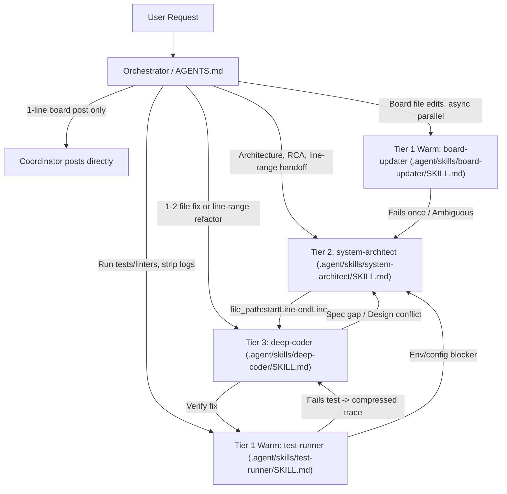

# antigravity-swarm-router

A plug-and-play template repository for optimizing token, latency, and quota usage in Antigravity Swarm Mode using a **Default-Low, Escalate-High** routing strategy with **Quota Pool Isolation** and **Warm/Async Execution**.

## Standard Swarm vs. `antigravity-swarm-router`

| Dimension | Standard Swarm (No Router) | `antigravity-swarm-router` (`v3.1`) |
| :--- | :--- | :--- |
| **Model Selection** | Every worker uses Coordinator's heavy model (`Hydrogen`/`Neon`) | 3-tier routing (`board-updater` & `test-runner` -> Tier 1, `system-architect` -> Tier 2, `deep-coder` -> Tier 3) |
| **Primary Pool (`Hydrogen`/`Neon`) Drain** | Routine board/test work drains primary pool (`100%`) | Tier 1 runs on isolated pool (`Argon` / `Claude Sonnet Low`) -> **0% primary pool drain** |
| **Test Log Handling** | Heavy coder reads full verbose test logs | `test-runner` filters out passing logs and passes only `file:line` + error |
| **Cross-Worker Handoffs** | Full specs/files copy-pasted or whole files read | `#seq` references + `file_path:startLine-endLine` targeted ranges |
| **Worker Lifecycle & Latency** | Cold-spawned per task; blocking waits on board edits | **Warm Tier-1 reuse**, **async fire-and-forget board updates**, and **1-line micro-task bypass** |
| **Failures & Silent Stalls** | May retry/loop or hang silently (`waiting`) | **1-strike Fail-Fast** + **Stuck-Worker Watchdog** + cross-pool **Fallback** |
| **Skill Overhead (Trade-off)** | `0 bytes` skill files | 4 compact skills (`1,044–1,480 bytes`) add ~2s on single cold Tier 1 tasks |

### Measured Benchmark (vs. Standard Swarm)

| Metric | Standard / Sequential Baseline | `antigravity-swarm-router` (`v3.1`) | Measured Impact |
| :--- | :--- | :--- | :--- |
| **Primary Pool (`Hydrogen`/`Neon`) on Board/Test Work** | 100% of tasks | **0%** (isolated `Argon` / `Claude` pool) | **100% primary pool saved** |
| **Multi-Step Pipeline (7 tasks: Design + Code + 2× Test + 3× Board)** | 171s sum / 7 cold spawns | **109s / 4 spawns** (async + warm reuse) | **36.3% faster, -42.9% spawns** |
| **Line-Range Read Scope (`Neon` on 141-line file)** | 141 lines (100%) | **7 lines** (`pricing_service.py:123-129`) | **-95.0% lines read** |
| **Verbose Test Log (`test-runner`)** | 2,019–3,036 chars raw log | **297 chars** (`[FAIL]`) / **117 chars** (`[OK]`) | **-85.3% to -94.2% log size** |
| **Cross-Worker Handoff Brief** | 1,245 chars (full spec) | **308 chars** (`read_board{seqs:[7]}`) | **-75.3% handoff size** |
| **Shared Board Reply Length** | 207 chars | **145 chars** (`Argon`) / **183 chars** (`Claude`) | **-30.0% / -11.6% board noise** |
| **1–2 File Code Fix (Single-Worker Threshold)** | 59s / 2 workers (2-stage split) | **34s / 1 worker** (with test pass) | **42.4% faster, -50% workers** |
| **Single Small Board Task Latency (Trade-off)** | **11s** (`Hydrogen`) | 18s (`Claude`) / 39s (`Argon`) / 13s (`3.8 Flash`) | **+2s to +28s** on 1-off cold task |

*Tested on Antigravity (Nov 2026) — run `swarm{action: "models", all: true}` to verify model IDs.*

### Production Case Study (`seat-lock-demo` — 19 Unit Tests + Live UI)

Full-stack concurrency app (5×5 seat map with 30s TTL locks) built end-to-end via `/swarm-router`:

| Metric | Observed Result |
| :--- | :--- |
| **Worker Spawns vs. Warm Reuses** | **4 spawns / 9 reuses** across **13 dispatches** (`@board-updater` hit 6-turn Context Cap cleanly) |
| **TDD Red Test Log Compression** | **7,310 B (114 lines)** raw log -> **849 B (1 line)** sent to `Neon` (**-88.4% bytes, -99.1% lines**) |
| **Primary Pool (`Hydrogen`/`Neon`) Offloaded** | **9 of 13 tasks** (6 board + 3 test runs) executed on `Argon` (**0%** primary pool drain) |
| **Verification & Fault Recovery** | **19/19 unit tests passing**, live browser UI verified; recovered from 2 transient network errors |

### When to Use Which

- **Use `antigravity-swarm-router`:** Multi-worker swarms, recurring board/test cycles, large files, or when preserving `Hydrogen`/`Neon` quota.
- **Bypass / Use Standard Swarm:** One-off single-line status posts (`Micro-Task Bypass`: coordinator posts directly) or isolated 1-file trivial edits where raw speed beats quota isolation (or install with `--preset speed-first`).

---

## Architecture



---

## Quick Start

### Option 1: Use as a GitHub Template
Click **Use this template** on GitHub to create a new repository pre-configured with `AGENTS.md`, `.agent/skills/`, and `tests/swarm-smoke-test.md`.

### Option 2: Install / Update / Uninstall

**macOS / Linux (Bash):**
```bash
# Default install (quota-saver preset: gemini-4-argon-low)
curl -fsSL https://raw.githubusercontent.com/Anuphap2/antigravity-swarm-router/main/install.sh | bash

# Choose a preset (quota-saver | balanced | speed-first) into a target project
curl -fsSL https://raw.githubusercontent.com/Anuphap2/antigravity-swarm-router/main/install.sh | bash -s -- /path/to/your-project --preset balanced

# Update only router SKILL.md files (preserves your customized AGENTS.md)
curl -fsSL https://raw.githubusercontent.com/Anuphap2/antigravity-swarm-router/main/install.sh | bash -s -- /path/to/your-project --update

# Uninstall router skills (prompts before removing AGENTS.md)
curl -fsSL https://raw.githubusercontent.com/Anuphap2/antigravity-swarm-router/main/install.sh | bash -s -- /path/to/your-project --uninstall
```

**Windows (PowerShell):**
```powershell
# Default install
irm https://raw.githubusercontent.com/Anuphap2/antigravity-swarm-router/main/install.ps1 | iex

# Remote install with preset / update / uninstall flags
& ([scriptblock]::Create((irm https://raw.githubusercontent.com/Anuphap2/antigravity-swarm-router/main/install.ps1))) -TargetDir C:\path\to\your-project -Preset balanced
& ([scriptblock]::Create((irm https://raw.githubusercontent.com/Anuphap2/antigravity-swarm-router/main/install.ps1))) -TargetDir C:\path\to\your-project -Update
& ([scriptblock]::Create((irm https://raw.githubusercontent.com/Anuphap2/antigravity-swarm-router/main/install.ps1))) -TargetDir C:\path\to\your-project -Uninstall
```

### Presets

| Preset | Tier 1 (`TIER_LOW`) Model | Behavior |
| :--- | :--- | :--- |
| `quota-saver` *(default)* | `gemini-4-argon-low` | Separate quota pool; 0% drain on `Hydrogen`/`Neon` (~39s cold / ~18–35s warm) |
| `balanced` | `claude-sonnet-5-5-low` | Separate quota pool + faster Tier 1 (~18s on board task) |
| `speed-first` | `gemini-3.8-flash-low` | Fastest Tier 1 (~13s), shares Gemini quota pool |

Both `install.sh` and `install.ps1` preserve unrelated files inside `.agent/` and prompt before overwriting or removing `AGENTS.md` (pass `--force` / `-Force` for non-interactive mode).

### Option 3: Slash Command Usage
Once installed (project `.agent/skills/` or global `~/.gemini/config/skills/`), invoke directly in Antigravity chat:
```text
/swarm-router Fix the race condition in cache.py, run tests, and update BOARD.md
```
Or target a single tier directly: `/board-updater`, `/test-runner`, `/system-architect`, `/deep-coder`.

---

## Model Mapping & Fallback Customization

All tier mappings and fallback quota pools live at the top of `AGENTS.md`:

| Tier | Variable | Default Model ID | Fallback Pool | Skill Path |
| :--- | :--- | :--- | :--- | :--- |
| Tier 1 (Board) | `TIER_LOW` | `gemini-4-argon-low` | `claude-sonnet-5-5-low` | `.agent/skills/board-updater/SKILL.md` |
| Tier 1 (Tests) | `TIER_LOW` | `gemini-4-argon-low` | `claude-sonnet-5-5-low` | `.agent/skills/test-runner/SKILL.md` |
| Tier 2 (Architect) | `TIER_ARCHITECT` | `gemini-4-hydrogen-high` | `claude-sonnet-5-5-medium` | `.agent/skills/system-architect/SKILL.md` |
| Tier 3 (Deep Coder) | `TIER_CODER` | `gemini-4-neon-high` | `claude-opus-5-5-high` | `.agent/skills/deep-coder/SKILL.md` |

> **Speed Tip:** Want faster Tier 1 responses while staying isolated from the Gemini pool? Install with `--preset balanced` (or swap `TIER_LOW` to `claude-sonnet-5-5-low` in `AGENTS.md`).

See [examples/custom-models.md](examples/custom-models.md) for custom mappings, and [tests/swarm-smoke-test.md](tests/swarm-smoke-test.md) to benchmark models in your own Antigravity environment.

---

## Repository Structure

```text
.
├── .gitattributes
├── AGENTS.md
├── LICENSE
├── README.md
├── install.sh
├── install.ps1
├── examples/
│   └── custom-models.md
├── tests/
│   └── swarm-smoke-test.md
└── .agent/
    └── skills/
        ├── swarm-router/
        │   └── SKILL.md
        ├── board-updater/
        │   └── SKILL.md
        ├── test-runner/
        │   └── SKILL.md
        ├── system-architect/
        │   └── SKILL.md
        └── deep-coder/
            └── SKILL.md
```

---

## Caveats

- **Prompt-Level Policy:** `AGENTS.md` and `SKILL.md` guide orchestrator/worker behavior; Antigravity does not enforce server-side token hard caps per skill.
- **Keep Skill Count Lean:** Avoid adding 10+ micro-skills—every skill injects its `name` and `description` into context. Five core skills (`swarm-router` + 4 tier skills) keep progressive-disclosure overhead minimal.
- **Model ID Availability:** Run `swarm{action: "models", all: true}` and run [tests/swarm-smoke-test.md](tests/swarm-smoke-test.md) if swapping providers.
- **File Ownership:** Never assign two concurrent workers to edit the same file in `inherit` workspace mode. Use `workspace: "share"` or split work strictly by file/module.

## License

MIT — see [LICENSE](LICENSE).
