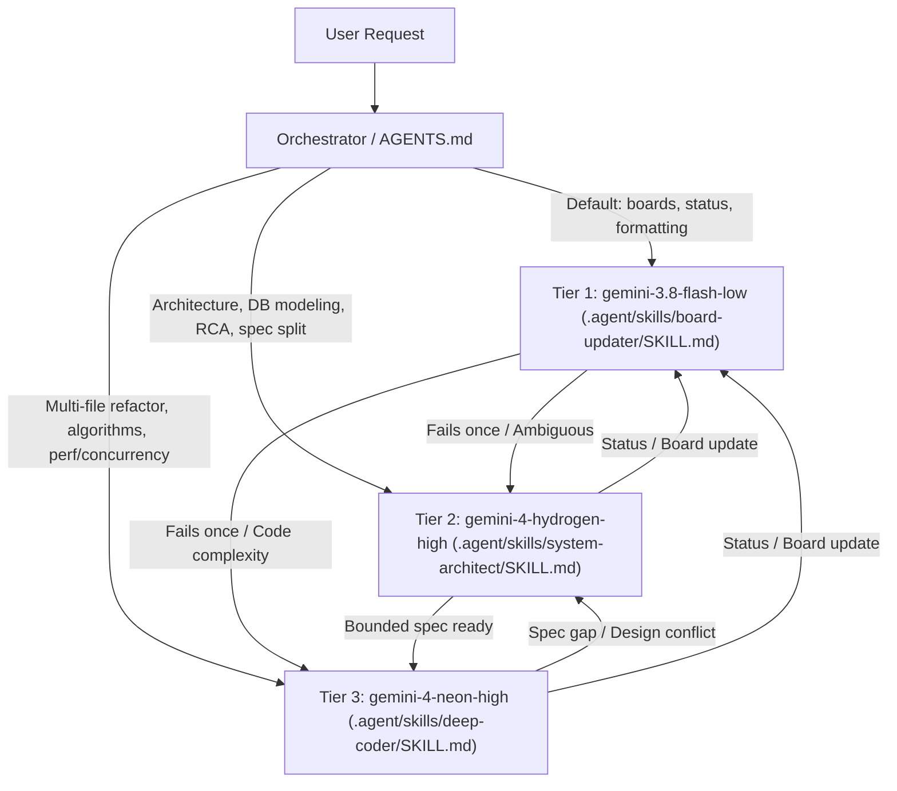

# antigravity-swarm-router

A plug-and-play template repository for optimizing token usage in Antigravity Swarm Mode using a **Default-Low, Escalate-High** model routing strategy.

## Problem & Solution

**Problem:** Running every swarm worker on a frontier model wastes quota and latency on mechanical work (board updates, status summaries, formatting), while forwarding full context balloons prompt tokens across workers.

**Solution:** `antigravity-swarm-router` enforces a three-tier routing policy in `AGENTS.md` paired with scoped `.agent/skills/*/SKILL.md` definitions:

1. **Default-Low:** Start routine and mechanical tasks on `gemini-3.8-flash-low` (`board-updater`).
2. **Escalate-High:** Route architectural design and root-cause analysis to `gemini-4-hydrogen-high` (`system-architect`), and multi-file coding/concurrency work to `gemini-4-neon-high` (`deep-coder`).
3. **Fail-Fast & Minimal Handoff:** Workers receive only relevant file paths/lines, return concise `@coordinator [done] [OK]`/`[ERROR]` outputs, and escalate immediately on the first Tier 1 failure instead of looping.

---

## Architecture



---

## Quick Start

### Option 1: Use as a GitHub Template
Click **Use this template** on GitHub to create a new repository pre-configured with `AGENTS.md` and `.agent/skills/`.

### Option 2: Install into an Existing Project (One-Liner)

**macOS / Linux (Bash):**
```bash
curl -fsSL https://raw.githubusercontent.com/Anuphap2/antigravity-swarm-router/main/install.sh | bash
```

Target a specific directory:
```bash
curl -fsSL https://raw.githubusercontent.com/Anuphap2/antigravity-swarm-router/main/install.sh | bash -s -- /path/to/your-project
```

**Windows (PowerShell):**
```powershell
irm https://raw.githubusercontent.com/Anuphap2/antigravity-swarm-router/main/install.ps1 | iex
```

Target a specific directory from a local clone:
```powershell
.\install.ps1 -TargetDir C:\path\to\your-project
```

### Option 3: Local Clone

```bash
git clone https://github.com/Anuphap2/antigravity-swarm-router.git
./antigravity-swarm-router/install.sh /path/to/your-project
```

Both `install.sh` and `install.ps1` preserve unrelated files inside `.agent/` and prompt before overwriting an existing `AGENTS.md` (pass `--force` / `-Force` to overwrite non-interactively).

---

## Model Mapping Customization

All tier mappings live in the **Model Configuration** table at the very top of `AGENTS.md`:

| Tier | Variable | Default Model ID | Skill Path |
| :--- | :--- | :--- | :--- |
| Tier 1 | `TIER_LOW` | `gemini-3.8-flash-low` | `.agent/skills/board-updater/SKILL.md` |
| Tier 2 | `TIER_ARCHITECT` | `gemini-4-hydrogen-high` | `.agent/skills/system-architect/SKILL.md` |
| Tier 3 | `TIER_CODER` | `gemini-4-neon-high` | `.agent/skills/deep-coder/SKILL.md` |

To swap models, edit the table in `AGENTS.md` (and optionally the `model:` field in `.agent/skills/*/SKILL.md`). See [examples/custom-models.md](examples/custom-models.md) for examples.

---

## Repository Structure

```text
.
├── AGENTS.md
├── LICENSE
├── README.md
├── install.sh
├── install.ps1
├── examples/
│   └── custom-models.md
└── .agent/
    └── skills/
        ├── board-updater/
        │   └── SKILL.md
        ├── system-architect/
        │   └── SKILL.md
        └── deep-coder/
            └── SKILL.md
```

---

## Caveats

- **Model ID Availability:** `gemini-3.8-flash-low`, `gemini-4-hydrogen-high`, and `gemini-4-neon-high` must match model IDs enabled in your Antigravity session (`swarm{action: "models", all: true}`). Update `AGENTS.md` if your account uses different identifiers.
- **File Ownership:** Never assign two concurrent workers to edit the same file in `inherit` workspace mode. Use `workspace: "share"` or split work strictly by file/module.

## License

MIT — see [LICENSE](LICENSE).
