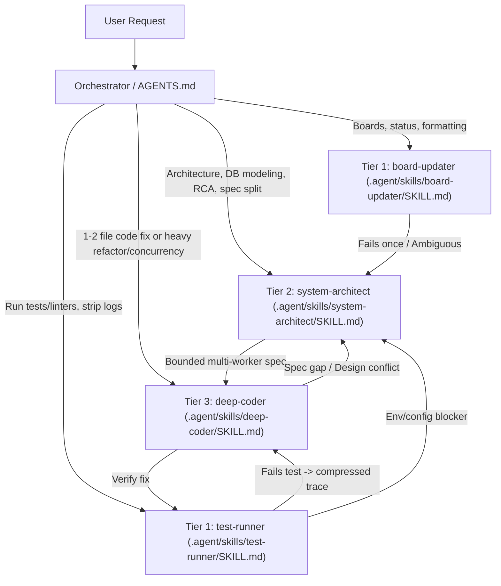

# antigravity-swarm-router

A plug-and-play template repository for optimizing token and quota usage in Antigravity Swarm Mode using a **Default-Low, Escalate-High** model routing strategy with **Quota Pool Isolation**.

## Problem & Solution

**Problem:** Running every swarm worker on a frontier model wastes quota and latency on mechanical work (board updates, test-log filtering, formatting), while sharing one quota bucket across tiers still drains your primary coding quota.

**Solution:** `antigravity-swarm-router` enforces a four-skill routing policy in `AGENTS.md` paired with compact `.agent/skills/*/SKILL.md` definitions:

1. **Default-Low (Isolated Pool):** Route board/formatting work (`board-updater`) and verbose test runs (`test-runner`) to Tier 1 (`gemini-4-argon-low` or `claude-sonnet-5-5-low`) so they do not consume `Hydrogen`/`Neon` quota.
2. **Single-Worker Threshold & Escalate-High:** Keep simple 1–2 file fixes on a single worker; escalate only true architectural/RCA work to `gemini-4-hydrogen-high` (`system-architect`) and heavy multi-file/concurrency coding to `gemini-4-neon-high` (`deep-coder`).
3. **Fail-Fast & Stuck-Worker Watchdog:** Reference prior board posts by `#seq`, return concise `@coordinator [done] [OK]`/`[FAIL]`/`[ERROR]` outputs, kill/switch silent stalled workers immediately, and fail over across independent quota pools.

---

## Architecture



---

## Quick Start

### Option 1: Use as a GitHub Template
Click **Use this template** on GitHub to create a new repository pre-configured with `AGENTS.md`, `.agent/skills/`, and `tests/swarm-smoke-test.md`.

### Option 2: Install / Update / Uninstall

**macOS / Linux (Bash):**
```bash
# Default install (quota-saver preset: gemini-4-argon-low)
curl -fsSL https://raw.githubusercontent.com/Anuphap2/antigravity-swarm-router/main/install.sh | bash

# Choose a preset (quota-saver | balanced | speed-first) into a target project
curl -fsSL https://raw.githubusercontent.com/Anuphap2/antigravity-swarm-router/main/install.sh | bash -s -- /path/to/your-project --preset balanced

# Update only router SKILL.md files (preserves your customized AGENTS.md)
curl -fsSL https://raw.githubusercontent.com/Anuphap2/antigravity-swarm-router/main/install.sh | bash -s -- /path/to/your-project --update

# Uninstall router skills (prompts before removing AGENTS.md)
curl -fsSL https://raw.githubusercontent.com/Anuphap2/antigravity-swarm-router/main/install.sh | bash -s -- /path/to/your-project --uninstall
```

**Windows (PowerShell):**
```powershell
# Default install
irm https://raw.githubusercontent.com/Anuphap2/antigravity-swarm-router/main/install.ps1 | iex

# Remote install with preset / update / uninstall flags
& ([scriptblock]::Create((irm https://raw.githubusercontent.com/Anuphap2/antigravity-swarm-router/main/install.ps1))) -TargetDir C:\path\to\your-project -Preset balanced
& ([scriptblock]::Create((irm https://raw.githubusercontent.com/Anuphap2/antigravity-swarm-router/main/install.ps1))) -TargetDir C:\path\to\your-project -Update
& ([scriptblock]::Create((irm https://raw.githubusercontent.com/Anuphap2/antigravity-swarm-router/main/install.ps1))) -TargetDir C:\path\to\your-project -Uninstall
```

### Presets

| Preset | Tier 1 (`TIER_LOW`) Model | Behavior |
| :--- | :--- | :--- |
| `quota-saver` *(default)* | `gemini-4-argon-low` | Separate quota pool; 0% drain on `Hydrogen`/`Neon` (~39s on board task) |
| `balanced` | `claude-sonnet-5-5-low` | Separate quota pool + ~2x faster than Argon (~18s on board task) |
| `speed-first` | `gemini-3.8-flash-low` | Fastest Tier 1 (~13s), shares Gemini quota pool |

Both `install.sh` and `install.ps1` preserve unrelated files inside `.agent/` and prompt before overwriting or removing `AGENTS.md` (pass `--force` / `-Force` for non-interactive mode).

---

## Model Mapping & Fallback Customization

All tier mappings and fallback quota pools live at the top of `AGENTS.md`:

| Tier | Variable | Default Model ID | Fallback Pool | Skill Path |
| :--- | :--- | :--- | :--- | :--- |
| Tier 1 (Board) | `TIER_LOW` | `gemini-4-argon-low` | `claude-sonnet-5-5-low` | `.agent/skills/board-updater/SKILL.md` |
| Tier 1 (Tests) | `TIER_LOW` | `gemini-4-argon-low` | `claude-sonnet-5-5-low` | `.agent/skills/test-runner/SKILL.md` |
| Tier 2 (Architect) | `TIER_ARCHITECT` | `gemini-4-hydrogen-high` | `claude-sonnet-5-5-medium` | `.agent/skills/system-architect/SKILL.md` |
| Tier 3 (Deep Coder) | `TIER_CODER` | `gemini-4-neon-high` | `claude-opus-5-5-high` | `.agent/skills/deep-coder/SKILL.md` |

> **Speed Tip:** Want faster Tier 1 responses while staying isolated from the Gemini pool? Install with `--preset balanced` (or swap `TIER_LOW` to `claude-sonnet-5-5-low` in `AGENTS.md`).

See [examples/custom-models.md](examples/custom-models.md) for custom mappings, and [tests/swarm-smoke-test.md](tests/swarm-smoke-test.md) to benchmark models in your own Antigravity environment.

---

## Benchmark (vs. Standard Swarm)

| Metric | Standard Swarm | `antigravity-swarm-router` | Measured Impact |
| :--- | :--- | :--- | :--- |
| **Primary Pool (`Hydrogen`/`Neon`) on Board/Test Work** | 100% of tasks | **0%** (isolated `Argon` / `Claude` pool) | **100% primary pool saved** |
| **Shared Board Reply Length** | 207 chars | 145 chars (`Argon`) / 183 chars (`Claude`) | **-30.0% / -11.6% board noise** |
| **Cross-Worker Handoff Brief** | 1,245 chars (full spec) | 308 chars (`read_board{seqs:[7]}`) | **-75.3% handoff size** |
| **Verbose Test Log (`test-runner`)** | 3,036 chars / 66 lines raw log | **316 chars / 1 line** (`Argon`, 15s) | **-89.6% test log size** |
| **1–2 File Code Fix (Single-Worker Threshold)** | 59s / 2 workers (2-stage split) | **34s / 1 worker** (with test pass) | **42.4% faster, -50% workers** |
| **Fail-Fast on Missing Target** | May retry/loop | Stops in **1 turn (8s)** -> `ESCALATE` | **Zero retry loops** |
| **Single Small Board Task Latency (Trade-off)** | **11s** (`Hydrogen`) | 39s (`Argon`) / 18s (`Claude`) / 13s (`3.8 Flash`) | **+7s to +28s** (`SKILL.md` load + model speed) |

*Tested on Antigravity (Nov 2026) — run `swarm{action: "models", all: true}` to verify model IDs.*

---

## Repository Structure

```text
.
├── AGENTS.md
├── LICENSE
├── README.md
├── install.sh
├── install.ps1
├── examples/
│   └── custom-models.md
├── tests/
│   └── swarm-smoke-test.md
└── .agent/
    └── skills/
        ├── board-updater/
        │   └── SKILL.md
        ├── test-runner/
        │   └── SKILL.md
        ├── system-architect/
        │   └── SKILL.md
        └── deep-coder/
            └── SKILL.md
```

---

## Caveats

- **Prompt-Level Policy:** `AGENTS.md` and `SKILL.md` guide orchestrator/worker behavior; Antigravity does not enforce server-side token hard caps per skill.
- **Keep Skill Count Lean:** Avoid adding 10+ micro-skills—every skill injects its `name` and `description` into context. Four core skills keep progressive-disclosure overhead minimal.
- **Model ID Availability:** Run `swarm{action: "models", all: true}` and run [tests/swarm-smoke-test.md](tests/swarm-smoke-test.md) if swapping providers.
- **File Ownership:** Never assign two concurrent workers to edit the same file in `inherit` workspace mode. Use `workspace: "share"` or split work strictly by file/module.

## License

MIT — see [LICENSE](LICENSE).
