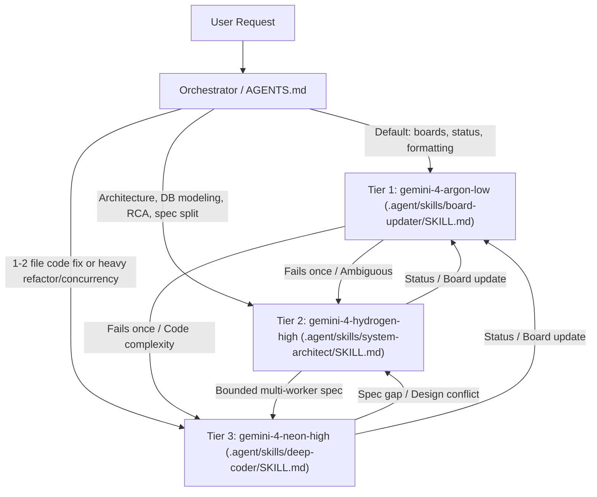

# antigravity-swarm-router

A plug-and-play template repository for optimizing token and quota usage in Antigravity Swarm Mode using a **Default-Low, Escalate-High** model routing strategy with **Quota Pool Isolation**.

## Problem & Solution

**Problem:** Running every swarm worker on a frontier model wastes quota and latency on mechanical work (board updates, status summaries, formatting), while sharing one quota bucket across tiers still drains your primary coding quota.

**Solution:** `antigravity-swarm-router` enforces a three-tier routing policy in `AGENTS.md` paired with compact `.agent/skills/*/SKILL.md` definitions:

1. **Default-Low (Isolated Pool):** Route routine/board work to `gemini-4-argon-low` (`board-updater`) so it does not consume `Hydrogen`/`Neon` quota.
2. **Single-Worker Threshold & Escalate-High:** Keep simple 1–2 file fixes on a single worker; escalate only true architectural/RCA work to `gemini-4-hydrogen-high` (`system-architect`) and heavy multi-file/concurrency coding to `gemini-4-neon-high` (`deep-coder`).
3. **Fail-Fast & Minimal Handoff:** Reference prior board posts by `#seq`, return concise `@coordinator [done] [OK]`/`[ERROR]` outputs, and escalate on the first Tier 1 failure (using `swarm{action: "model"}` when preserving warm context, plus a cross-provider fallback pool).

---

## Architecture



---

## Quick Start

### Option 1: Use as a GitHub Template
Click **Use this template** on GitHub to create a new repository pre-configured with `AGENTS.md` and `.agent/skills/`.

### Option 2: Install into an Existing Project (One-Liner)

**macOS / Linux (Bash):**
```bash
curl -fsSL https://raw.githubusercontent.com/Anuphap2/antigravity-swarm-router/main/install.sh | bash
```

Target a specific directory:
```bash
curl -fsSL https://raw.githubusercontent.com/Anuphap2/antigravity-swarm-router/main/install.sh | bash -s -- /path/to/your-project
```

**Windows (PowerShell):**
```powershell
irm https://raw.githubusercontent.com/Anuphap2/antigravity-swarm-router/main/install.ps1 | iex
```

Target a specific directory from a local clone:
```powershell
.\install.ps1 -TargetDir C:\path\to\your-project
```

### Option 3: Local Clone

```bash
git clone https://github.com/Anuphap2/antigravity-swarm-router.git
./antigravity-swarm-router/install.sh /path/to/your-project
```

Both `install.sh` and `install.ps1` preserve unrelated files inside `.agent/` and prompt before overwriting an existing `AGENTS.md` (pass `--force` / `-Force` to overwrite non-interactively).

---

## Model Mapping & Fallback Customization

All tier mappings and fallback quota pools live at the top of `AGENTS.md`:

| Tier | Variable | Default Model ID | Fallback Pool | Skill Path |
| :--- | :--- | :--- | :--- | :--- |
| Tier 1 | `TIER_LOW` | `gemini-4-argon-low` | `claude-sonnet-5-5-low` | `.agent/skills/board-updater/SKILL.md` |
| Tier 2 | `TIER_ARCHITECT` | `gemini-4-hydrogen-high` | `claude-sonnet-5-5-medium` | `.agent/skills/system-architect/SKILL.md` |
| Tier 3 | `TIER_CODER` | `gemini-4-neon-high` | `claude-opus-5-5-high` | `.agent/skills/deep-coder/SKILL.md` |

> **Speed Tip:** Want faster Tier 1 responses while staying isolated from the Gemini pool? Swap `TIER_LOW` from `gemini-4-argon-low` (~39s) to `claude-sonnet-5-5-low` (~18s) in `AGENTS.md`.

See [examples/custom-models.md](examples/custom-models.md) for customization examples.

---

## Benchmark (vs. Standard Swarm)

| Metric | Standard Swarm | `antigravity-swarm-router` (`v2`) | Measured Impact |
| :--- | :--- | :--- | :--- |
| **Primary Pool (`Hydrogen`/`Neon`) on Board Work** | 100% of tasks | **0%** (isolated `Argon` / `Claude` pool) | **100% primary pool saved** |
| **Shared Board Reply Length** | 207 chars | 145 chars (`Argon`) / 183 chars (`Claude`) | **-30.0% / -11.6% board noise** |
| **Cross-Worker Handoff Brief** | 1,245 chars (full spec) | 308 chars (`read_board{seqs:[7]}`) | **-75.3% handoff size** |
| **1–2 File Code Fix (Single-Worker Threshold)** | 59s / 2 workers (2-stage split) | **34s / 1 worker** (with test pass) | **42.4% faster, -50% workers** |
| **Fail-Fast on Missing Target** | May retry/loop | Stops in **1 turn (8s)** -> `ESCALATE` | **Zero retry loops** |
| **Single Small Board Task Latency (Trade-off)** | **11s** (`Hydrogen`) | 39s (`Argon`) / 18s (`Claude`) / 13s (`3.8 Flash`) | **+7s to +28s** (`SKILL.md` load + model speed) |

*Tested on Antigravity (Nov 2026) — run `swarm{action: "models", all: true}` to verify model IDs.*

---

## Repository Structure

```text
.
├── AGENTS.md
├── LICENSE
├── README.md
├── install.sh
├── install.ps1
├── examples/
│   └── custom-models.md
└── .agent/
    └── skills/
        ├── board-updater/
        │   └── SKILL.md
        ├── system-architect/
        │   └── SKILL.md
        └── deep-coder/
            └── SKILL.md
```

---

## Caveats

- **Model ID Availability:** `gemini-4-argon-low`, `gemini-4-hydrogen-high`, and `gemini-4-neon-high` must match model IDs enabled in your Antigravity session (`swarm{action: "models", all: true}`). Update `AGENTS.md` if your account uses different identifiers.
- **File Ownership:** Never assign two concurrent workers to edit the same file in `inherit` workspace mode. Use `workspace: "share"` or split work strictly by file/module.

## License

MIT — see [LICENSE](LICENSE).
